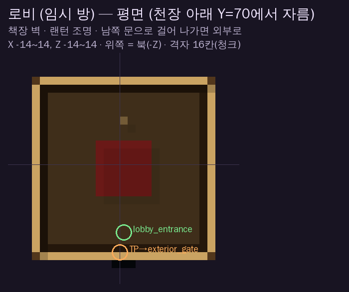
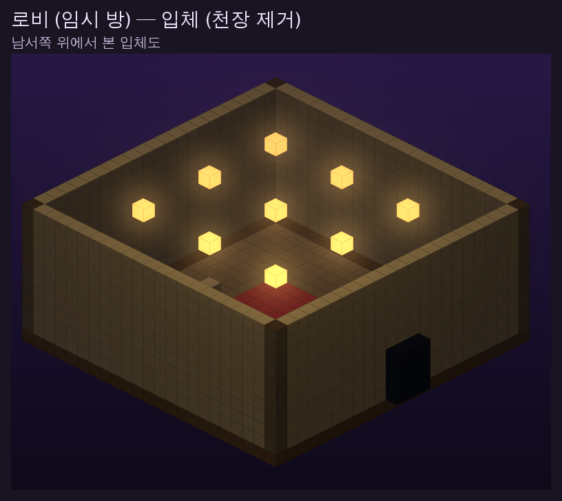

# 미리보기

폰에서 GitHub 앱/웹으로 이 폴더를 열면 그림을 볼 수 있습니다.
블록 데이터로 그린 근사 그림이라, 실제 게임(텍스처·조명·쉐이더)과는 다릅니다.

## 외부 (2차 수정: 비율·수관·빛기둥 건축물·종이 7줄기·도시·구름)

| 그림 | 내용 |
|---|---|
|  | 원화(위) / 맵(아래) — 스폰 지점에서 본 정문과 탑, 황금 종이 물결 |
|  | 원화(위, 탑 부분 확대) / 맵(아래) — 위로 좁아지는 몸통, 넓게 퍼지는 수관, 빛기둥 건축물 |
|  | 탑 올려다보기 — 끝이 말린 가지, 초승달 |
|  | 원화(위) / 맵(아래) — 위에서 본 분화구(원화와 비슷한 각도), 나선 구름, 빛기둥 |
|  | 외부 전체 입체도 |
|  | 위에서 본 평면 (스폰·TP 위치 표시) |

## 로비 (아직 임시 방)

| 그림 | 내용 |
|---|---|
|  | 평면 — 남쪽 문으로 걸어 나가면 외부 정문 앞으로 |
|  | 입체 |
