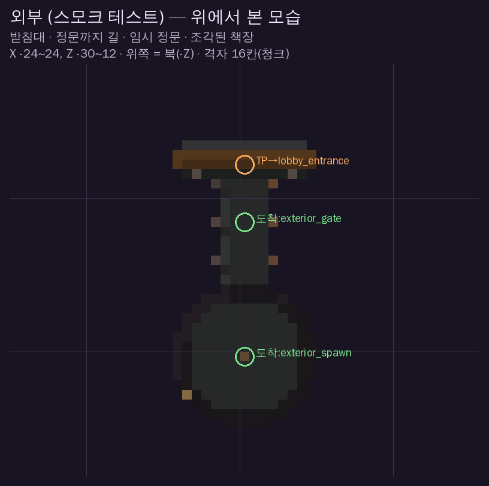
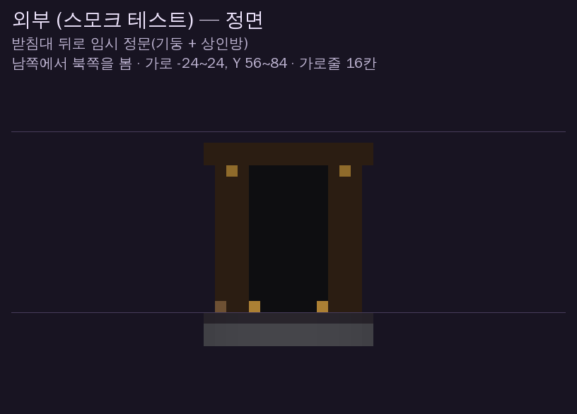
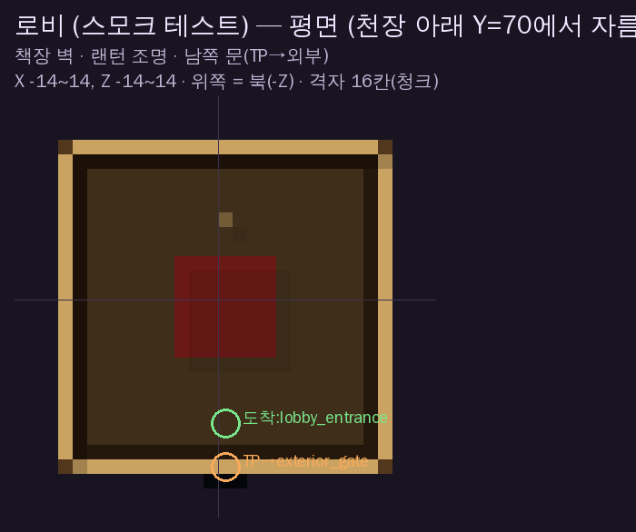
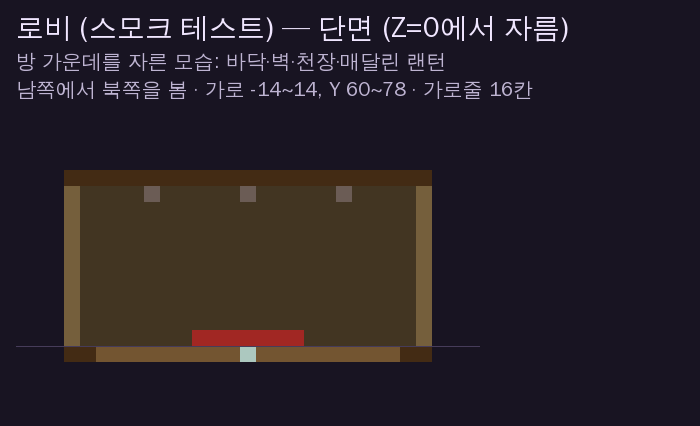
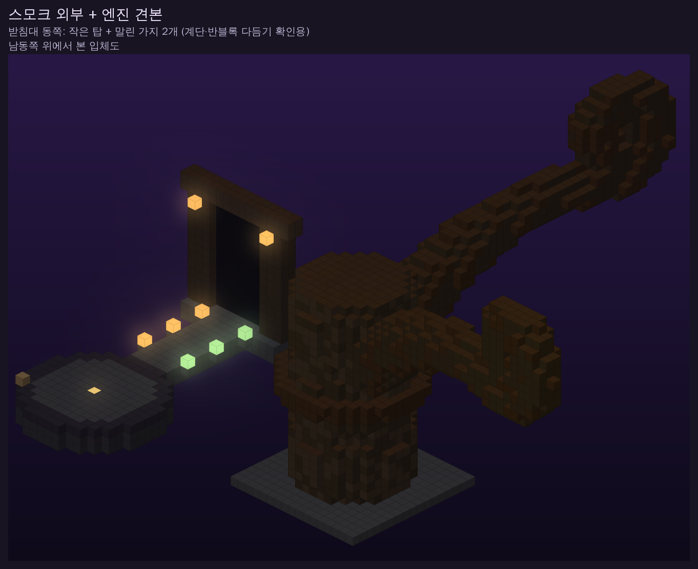
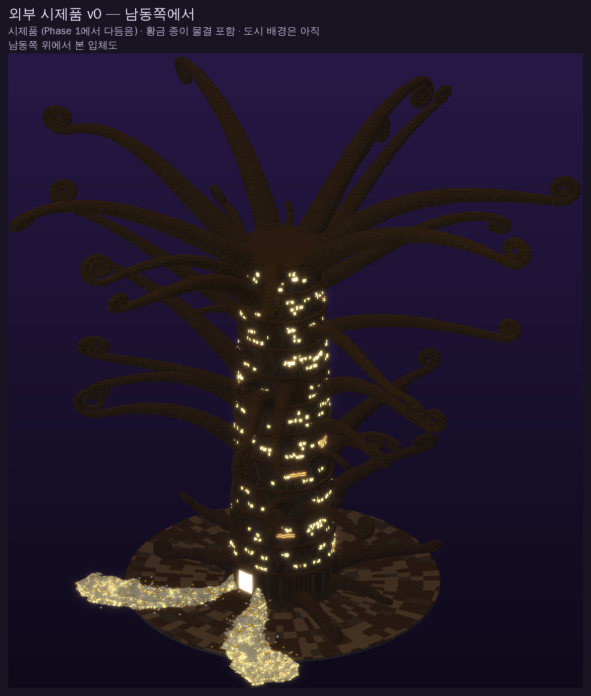
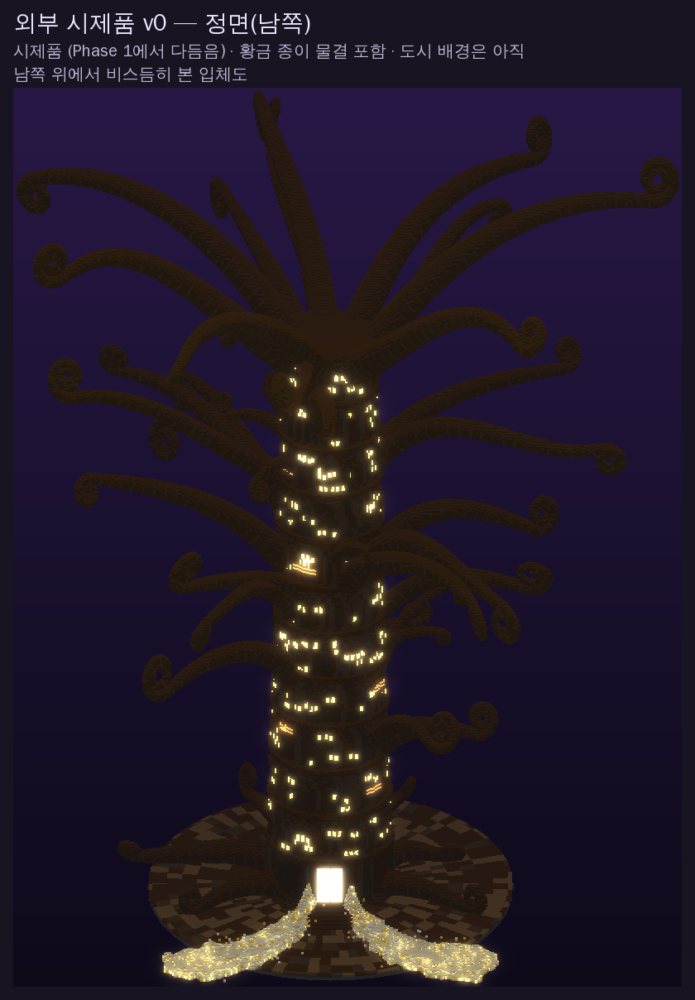
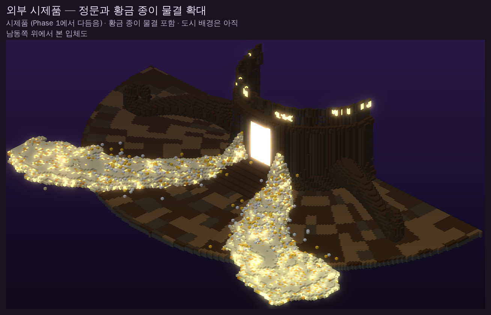

# 미리보기

폰에서 GitHub 앱/웹으로 이 폴더를 열면 그림을 볼 수 있습니다. 생성기 데이터로 그린 그림이라 실제 게임 화면(조명·쉐이더)과는 다릅니다.

## Phase 0 스모크 테스트 (임시 시험용 월드)

| 그림 | 내용 |
|---|---|
|  | 외부 — 위에서 본 모습. 초록 원 = TP 도착 지점, 주황 원 = 클릭하면 TP되는 곳 |
|  | 외부 — 정면(남쪽에서 북쪽을 본 모습) |
|  | 로비 — 평면도 (천장을 잘라낸 모습) |
|  | 로비 — 단면 |
|  | 외부 입체도 — 받침대 동쪽에 도형 엔진 견본(작은 탑 + 말린 가지, 테스터 확인 ⑨) |

## 도형 엔진 시연 — 외부 건물 시제품 v0

설계서(`design/exterior.md`) 수치로 만든 첫 시제품. 탑 11단, 창문 불빛, 정문, 끝이 말린 가지 41개, 뿌리, 원형 광장.
황금 종이 물결 추가 (정문 양옆 기단에서 흘러내려 앞으로 퍼짐, 발광 블록·흩어진 종이). 도시 배경·재질은 아직.

| 그림 | 내용 |
|---|---|
|  | 남동쪽 위에서 본 입체도 |
|  | 정면(남쪽) — 빛나는 정문과 계단 |
|  | 정문 앞 확대 — 황금 종이 물결 두 줄기 |
